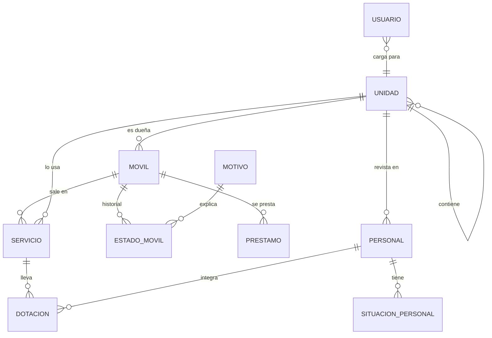

# Modelo de datos — App Agenda de Móviles

Borrador para el prototipo. Se ajusta con lo que salga de las entrevistas.

**Idea central:** la dotación no pertenece al móvil sino a un **servicio**, es decir, un móvil en un turno concreto. Así el mismo móvil puede tener otra dotación en cada turno y extenderse si queda retenido por un procedimiento.

## Diagrama

## Tablas

### Catálogos
| Tabla | Campos | Notas |
|---|---|---|
| `unidad` | id, nombre, tipo (general / dirección / departamento / división), padre_id | Toda la jerarquía en una tabla. Permite contar por cualquier nivel. |
| `turno` | id, nombre, hora inicio, hora fin, unidad_id (vacío = vale para todas) | Un juego de turnos común para todos. Si una división tiene una excepción, se carga un turno propio con su unidad_id. |
| `motivo` | id, nombre, categoría (fuera de servicio / procedimiento / comisión), gravedad (leve / grave) | Catálogo cerrado. Ejemplos: batería (leve), choque o mecánico (grave). |
| `designacion` | nombre, zona, unidad principal, tipo, activa, alias | Catálogo de nombres por zona relevado del SAE. El número se carga libre en cada servicio. A confirmar con el listado oficial. |
| `designacion_excepcion` | nombre, designación completa, unidad, móvil, usuario, fecha, estado (pendiente / agregada / descartada) | Nombres usados fuera de la lista. El General decide si pasan a `designacion`. |

### Móviles
| Tabla | Campos | Notas |
|---|---|---|
| `movil` | dominio (único), matrícula interna (única), tipo, marca, modelo, programa (Ojos en Alerta / Policial), unidad_dueña_id, activo, baja (motivo, fecha, observación, usuario) | La dueña no cambia. |
| `estado_movil` | movil_id, estado, motivo_id, observación, desde, hasta, cargado_por | Historial. El actual es el que no tiene "hasta". Estados: disponible, en servicio, fuera de servicio, retenido por procedimiento. |
| `prestamo` | movil_id, unidad_origen, unidad_destino, desde, hasta, autorizado_por, con_dotación | Temporal, entre cualquier división o UT. Al cerrarlo el móvil vuelve a su dueña. Dentro de la dirección lo hace el cargador; hacia otra dirección, el administrador general. |

### Personal
| Tabla | Campos | Notas |
|---|---|---|
| `personal` | DNI, jerarquía, apellido y nombre, unidad_id, función habitual, personal de calle, guardia, horario, baja (motivo, fecha, observación, usuario) | Solo campos operativos. Sin domicilio, teléfono, arma ni chaleco. |
| `prestamo_personal` | DNI, unidad_origen, unidad_destino, fecha, turno, desde, hasta, autorizado_por | Un efectivo prestado a otra dirección por una guardia. En esa guardia aparece para la dirección que lo recibe y no para la suya. |
| `situacion_personal` | DNI, tipo (TNO, licencia médica, licencia anual, licencia especial, suspensión…), desde, hasta (opcional), observación, cargado_por | El sistema calcula la aptitud en cada fecha. |

### Agenda
| Tabla | Campos | Notas |
|---|---|---|
| `servicio` | movil_id, designación radial, unidad que lo usa, fecha, turno, inicio, fin previsto, fin real, estado | Fin real vacío mientras siga ocupado (ej. procedimiento pasado el cambio de turno). Lo cierra el administrador. |
| `designacion_historial` | servicio_id, designación, desde, hasta, cargado_por | Un móvil puede cambiar de designación por frecuencia (ej. URCA10 pasa a CENTENO20). Permite ubicarlo por la designación anterior. |
| `dotacion` | servicio_id, DNI, rol (jefe de coche / chofer / acompañante), desde, hasta | Horario propio por integrante: permite cambiar de móvil a mitad de turno. |

### Control
| Tabla | Campos | Notas |
|---|---|---|
| `usuario` | rol (administrador general / cargador / consulta), unidad_id | **Administrador general:** ve todo, supervisa lo que falta agendar, le reclama a los cargadores y es el único que deriva móviles y personal entre direcciones. **Cargador Norte / Sur:** carga solo lo de su dirección. **Monitoreo:** consulta todo y reporta móviles escuchados en frecuencia. |
| `cambio` | tabla (móvil / personal), registro_id, valores antes, valores después, usuario, fecha, deshecho_por, revierte_a | Guarda cada edición para poder volver atrás de a un paso. |
| `auditoria` | quién, qué, cuándo, valor anterior y nuevo | Cierra el problema de los números distintos. |

## Reglas que controla la base

1. Un móvil no puede estar en dos servicios abiertos a la vez, ni en servicio y fuera de servicio al mismo tiempo.
2. Una persona no puede estar en dos dotaciones que se superpongan en horario.
3. No se puede asignar a alguien no apto: TNO vigente, licencia, suspensión o que no sea de calle.
4. Un móvil prestado no se agenda desde su dirección dueña hasta cerrar el préstamo.
5. Un fuera de servicio exige motivo del catálogo.
6. Una designación radial no puede estar en dos servicios abiertos a la vez (a confirmar).

## Decisiones tomadas

- Toda edición de un móvil o una persona se puede deshacer desde el historial, de la más nueva a la más vieja. No se deshace si los datos cambiaron por otro lado, si el interno o la patente ahora son de otro móvil, o si el móvil está en servicio o prestado y el cambio era de división. Un alta equivocada se da de baja con el motivo "Cargado por error".

- La aptitud se calcula para la fecha del servicio: una licencia futura impide agendar a esa persona para esos días, pero no hoy.
- Si una situación vigente deja no apta a una persona que está en un móvil, sale de la dotación y queda registrado. La observación no guarda datos médicos y solo la ve quien puede editar a esa persona.

- Personal y móviles no se borran: la baja guarda motivo, fecha, observación y usuario, y se puede revertir. La historia de servicios y dotaciones se conserva.
- Un cambio de división del personal se registra como pase en la auditoría. El DNI no se edita porque identifica a la persona.

- El sistema es flexible con la unidad de revista: se puede agendar personal de cualquier división o Dirección, por pases o excepciones, sin cambiar datos. Si es de otra Dirección, avisa y queda en auditoría. Solo bloquean el personal no apto y quien ya está en otro móvil, además del préstamo a otra unidad en esa guardia.

- **Dotación no fija:** se arma cada turno, sujeta a cambios. Opción de "copiar del turno anterior" solo como comodidad.
- **Cambio de móvil a mitad de turno:** permitido.
- **Turnos:** todos manejan los mismos rangos horarios, pero puede haber excepciones. Turnos comunes en un catálogo, excepciones por unidad, y cada servicio puede ajustar su inicio y fin a mano.
- **Integrantes:** usualmente 2, a veces 1. Mínimo 1, sin máximo rígido; salir solo genera una advertencia. A confirmar en entrevista.

## Recuento por dirección

Propios − prestados a otra + recibidos en préstamo, separados por estado: en servicio, disponibles, fuera de servicio (por motivo) y retenidos por procedimiento. Sale de las mismas tablas para todos.
